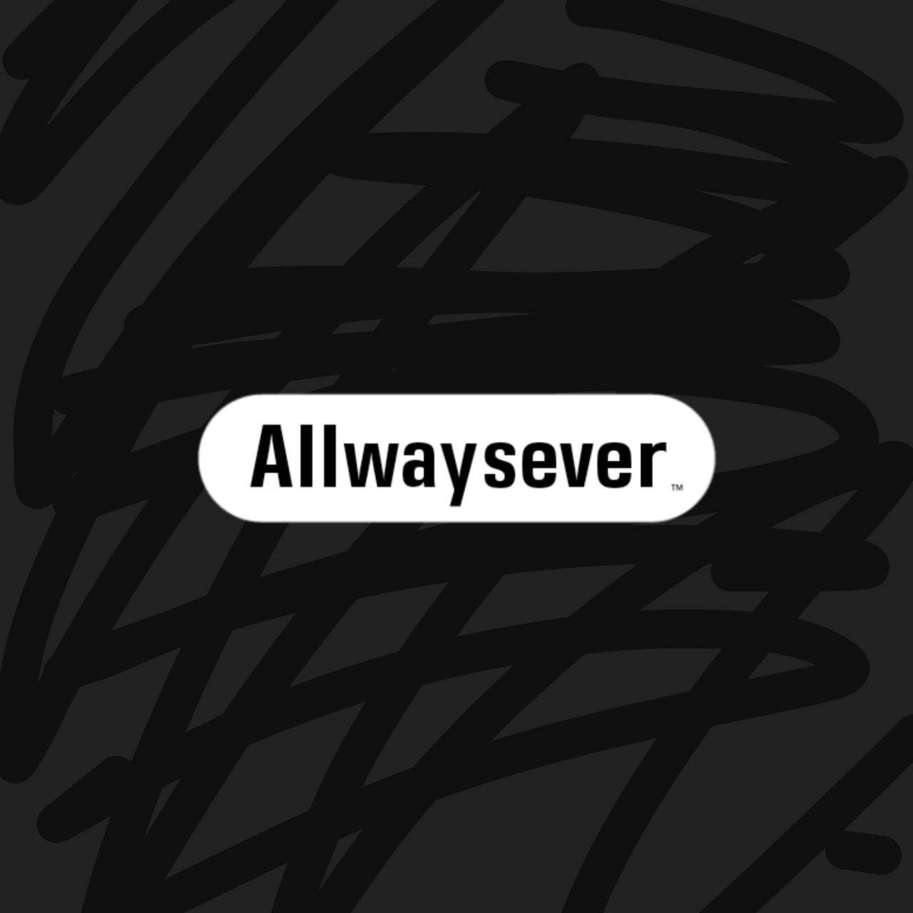

<!-- Ganti URL di bawah ini dengan URL gambar logo kamu setelah di-upload ke folder profile -->

  

<h1 align="center">All ways to create 4-ever</h1>

  <b>A random Studio that creates works that are not just websites and code.</b> 
  Based in Yogyakarta, Indonesia 🇮🇩

  <a href="https://allwaysever.blogspot.com">Website</a> •
  <a href="https://youtube.com/@Allwaysever">YouTube</a> •
  <a href="https://instagram.com/allwaysever">Instagram</a> •
  <a href="https://facebook.com/Allwaysever.id">Facebook</a> •
  <a href="https://gitlab.com/Allwaysever">GitLab</a>

---

### 👋 Welcome to Allwaysever!

We are a random studio driven by curiosity and a passion for building things. We believe that creation doesn't always have to be serious—sometimes the most useful tools start as fun experiments.

From crafting lightweight web interfaces to designing pure-CSS frameworks, we pour our creativity into every line of code. We explore the intersection of web technology, AI, and digital design to deliver visually immersive and efficient experiences.

### 🛠️ Our Tech Stack & Tools

  
  
  
  
  
  
  
  
  
  
  
  
  
  

---

### 🚀 Featured Projects

Here are some of the things we've been crafting:

<table>
  <tr>
    <td width="50%">
      <h3>SuperRoundedUI</h3>
      
A pure-CSS design system that combines warmth, friendliness, and efficiency. Built without a single line of JavaScript in its core, exclusively optimized for Dark Environments.

      
<b>Stack:</b> <code>CSS</code>

      <a href="https://github.com/Allwaysever/SuperRoundedUI"><b>Explore Repository →</b></a>
    </td>
    <td width="50%">
      <h3>epubCreator.js</h3>
      
A Node CLI App designed to make creating EPUB files easier and faster directly from your terminal.

      
<b>Stack:</b> <code>Node.js</code>, <code>JS</code>

      <a href="https://github.com/YogabyAllwaysever/epubCreator.js"><b>View Project →</b></a>
    </td>
  </tr>
  <tr>
    <td width="50%">
      <h3>MirAI (Archived)</h3>
      
A simple, lightweight, and responsive web interface to interact directly with the Google Gemini API.

      
<b>Stack:</b> <code>HTML</code>, <code>CSS</code>, <code>JS</code>

      <a href="https://github.com/Allwaysever/MirAI"><b>View Project →</b></a>
    </td>
    <td width="50%">
      <h3>AllwayseverOriginalsWeb</h3>
      
The original web space for our projects. Simple, straightforward, and built from scratch.

      
<b>Stack:</b> <code>HTML</code>

      <a href="https://github.com/Allwaysever/AllwayseverOriginalsWeb"><b>Check it out →</b></a>
    </td>
  </tr>
</table>

---

### 💡 Got an Idea?

We are always open to collaborations, fun experiments, or just a good tech conversation. If you want to build something together or have any questions, feel free to reach out to us through our social channels!

---

  <i>"All ways to create 4-ever."</i> ™

